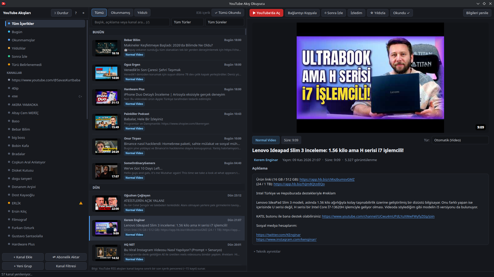

# YouTube Feed Reader · YouTube Akış Okuyucu

A YouTube-focused desktop RSS reader with per-channel controls for **regular videos, Shorts and live streams**. Built with Python, PySide6/Qt 6 and SQLite, and developed on Fedora KDE/Wayland.



## Features

- Separate regular videos, Shorts and live streams; choose which types to show for each channel.
- Dark three-pane interface with channel groups, search and unread/starred views.
- Select the subscriptions you want to import from Google Takeout CSV/JSON, OPML/XML, supported subscription JSON files, pasted channel lists or an existing browser session.
- Watch Later queue with persistent ordering and a watched status independent of read/starred status.
- Duration badges and filters: under 5 minutes, 5–15, 15–30, 30+ and unknown duration.
- Channel/type notification preferences, live-start notifications and optional close-to-tray behavior.
- OPML export and versioned JSON backups for subscriptions, preferences and saved content state.
- Manual content-type overrides and expandable classification details.
- Cached content and thumbnails, background refresh, and videos opened in your usual browser.

Public channel feeds do not require a YouTube Data API key. Optional browser subscription import uses `yt-dlp` to read a local browser profile that is already signed in to YouTube; support depends on the browser/profile and cookie access. File import is available as an alternative.

## Run from source

The application is currently distributed as source code. The development environment is **Fedora KDE/Wayland with Python 3.14**; other environments have not been verified.

Install Git and Python 3 if needed, then:

```bash
git clone https://github.com/bilalyusufersin/youtube-feed-reader.git
cd youtube-feed-reader
python3 -m venv .venv
source .venv/bin/activate
python -m pip install -r requirements.txt
python main.py
```

The interface is currently in Turkish. Main controls include **Kanal Ekle** (Add Channel), **Abonelik Aktar** (Import Subscriptions), **Kanal Filtresi** (Channel Filter), **Sonra İzle** (Watch Later) and **Bilgileri yenile** (Refresh Details).

### Add a channel or import a file

```bash
python main.py --add @GoogleDevelopers
python main.py --import-file /path/to/subscriptions.csv
```

Channel IDs, channel URLs and YouTube RSS URLs can also be added in the interface. The import dialog previews candidates so you can select which subscriptions to add.

### Linux application-menu integration

After installing the dependencies in the virtual environment:

```bash
python main.py --install-desktop
```

This creates a user-level launcher, application-menu entry, icons and a desktop shortcut when a supported desktop directory exists. Keep the project folder in place; rerun this command if you move it.

## Content classification

The reader combines type-specific YouTube upload feeds, channel-tab information and video metadata. Duration, a `#shorts` title tag or a thumbnail's aspect ratio alone are not treated as proof of content type.

Conflicting or insufficient evidence remains **unknown** and can be reviewed separately. Manual corrections are preserved when metadata is refreshed. Completed live streams remain in the live-stream category.

## Local data

Default locations follow XDG conventions:

| Data | Default location |
| --- | --- |
| SQLite database | `~/.local/share/ytrss/ytrss.sqlite3` |
| Thumbnail cache | `~/.cache/ytrss/thumbs/` |
| Window settings | `~/.config/ytrss/` |

`YTRSS_HOME` can redirect the application's data/cache/config directories for isolated runs. `--db` selects a custom database file. Personal subscriptions, browser profiles and local runtime databases are not included in this repository.

## Keyboard shortcuts

| Shortcut | Action |
| --- | --- |
| `J` / `K` | Next / previous video |
| `Enter` | Open selected video on YouTube |
| `W` | Toggle Watch Later |
| `I` | Toggle watched status |
| `M` | Toggle read status |
| `/` or `Ctrl+F` | Search |
| `F5` or `Ctrl+R` | Refresh |
| `F1` | Shortcut help |

## Tests

With the virtual environment activated:

```bash
QT_QPA_PLATFORM=offscreen python -m pytest -q
```

Tests cover classification fixtures, channel filtering, persistence and schema migration, import/export and backup merging, queue ordering, durations, notification deduplication and Qt interface behavior. Passing local tests does not guarantee that YouTube's live responses will stay unchanged.

## Current limits and feedback

- Feeds expose a limited recent-content window; this is not a complete channel-history archive.
- Refreshing is periodic, so discovery and live-start notices are not guaranteed to be instantaneous.
- YouTube responses and metadata extraction can change or fail. Some content may remain unclassified or unavailable.
- There is no Flatpak/RPM/AppImage distribution package yet.

This started as a personal tool for following YouTube subscriptions. Bug reports and practical feature requests are welcome through [GitHub Issues](https://github.com/bilalyusufersin/youtube-feed-reader/issues). For bugs, include the OS, Python version, reproduction steps and the relevant error message; omit account credentials and browser cookies.

## Türkçe

**YouTube Akış Okuyucu**, YouTube aboneliklerini normal video, Shorts ve canlı yayın olarak ayırarak takip etmek için geliştirdiğim bir masaüstü uygulamasıdır. Her kanalın içerik türü tercihleri ayrı seçilebilir. Tarayıcıdan veya abonelik dosyalarından seçerek kanal aktarma, süre filtresi, Sonra İzle, izlendi/okundu/yıldızlı durumları ve yedekleme özelliklerini içerir.

Yukarıdaki kurulum komutlarını sırasıyla çalıştırıp `python main.py` ile açabilirsiniz. Uygulama arayüzü Türkçedir. Fedora KDE/Wayland üzerinde geliştirilmiştir; YouTube akışlarının sınırlı son içerik penceresi ve türü doğrulanamayan içerikler gibi bilinen sınırlar yukarıda açıklanmıştır. Sorunları ve önerileri **Issues** bölümünden paylaşabilirsiniz.
